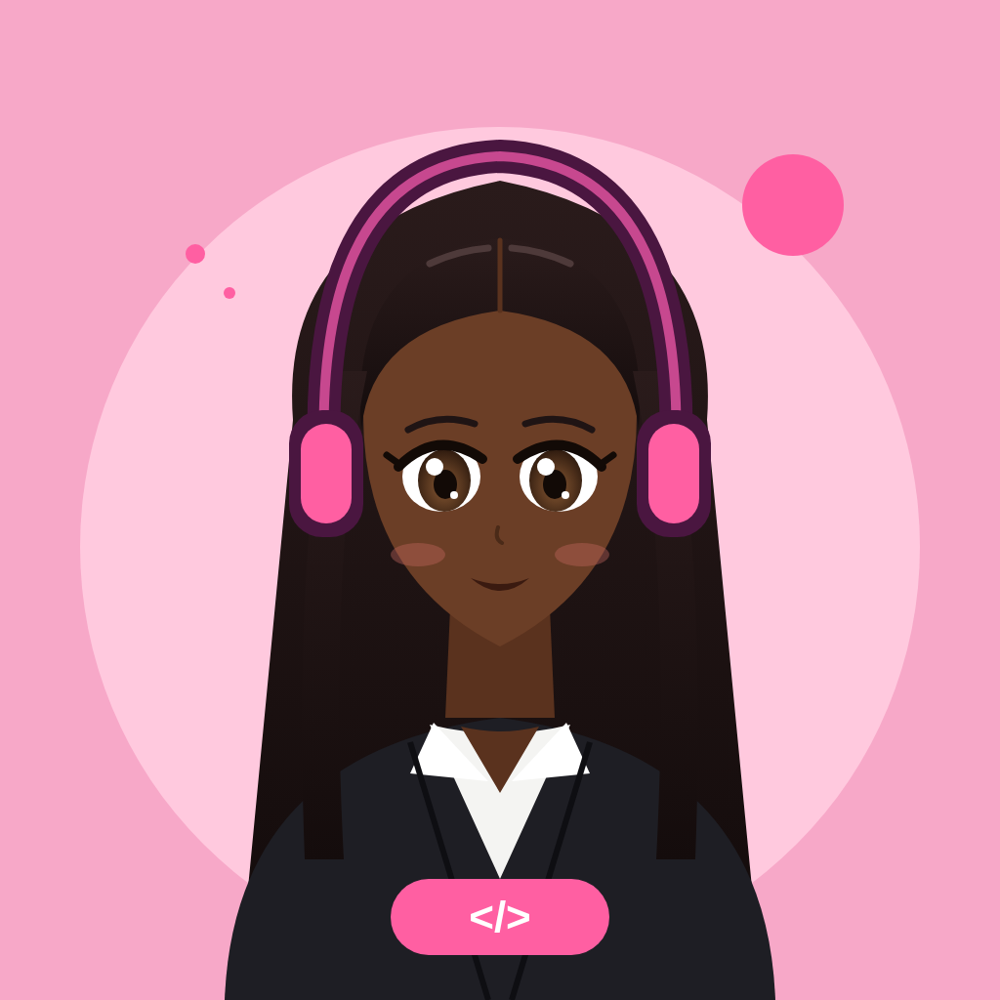

  

  
  
  

  

---

## 🌸 About me

Avuxeni! I'm **Hlayisane**, a developer from Pretoria who loves building apps and making data useful.

- 💼 **Digitalisation & IT Graduate** in the automotive industry, building apps, automations, dashboards and AI agents
- 🎓 **BSc IT** from North-West University, now completing a **BSc Honours in Computing** at UNISA
- 🛠️ Happiest when I'm turning a real business problem into a working solution, from requirements to release
- 🏆 **Top 10 finalist**, Girl Code Hackathon · **Top 10 Achiever** in C# (84%) · **Golden Key** member
- 🌱 Learning more about software engineering, machine learning and cloud data engineering
- ⚡ Fun fact: I love hackathons. Give me a problem and a deadline and I'll build something!

 

## 🚀 What I'm working on

| Project | What it does | Built with |
|---|---|---|
| [**Match Made**](https://github.com/Tumie074/MatchMade) | An AI opportunity matcher that shows young South Africans only the jobs, bursaries and programmes they qualify for, and gets them ready to apply | JavaScript, AI, Python |
| **StudentDev Hub** | A full-stack learning platform with career tracks, coding challenges and GitHub progress tracking | React, Node.js, Express, MongoDB |
| **Real-time BI system** | Sales analytics with real-time payment streaming and interactive dashboards | MongoDB, Apache Kafka, Power BI |

## 🧰 Tech stack

  

  
  
  
  
  
  
  
  
  

## 📊 GitHub stats

  
  

  

  

## 🤝 Let's connect

I'm open to collaborating on apps, data and AI projects, and always up for a hackathon. Say hi on [LinkedIn](https://www.linkedin.com/in/YOUR_LINKEDIN/)! 💕

  

